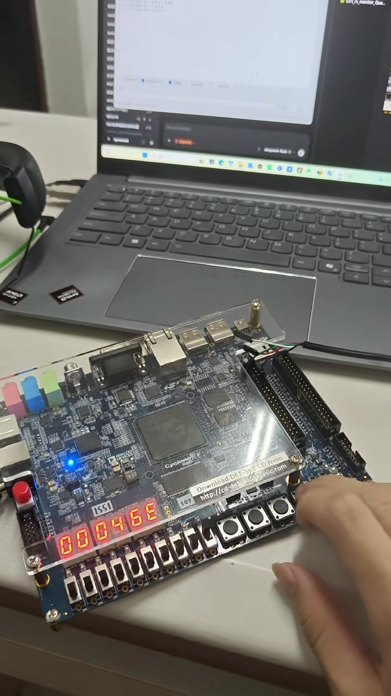
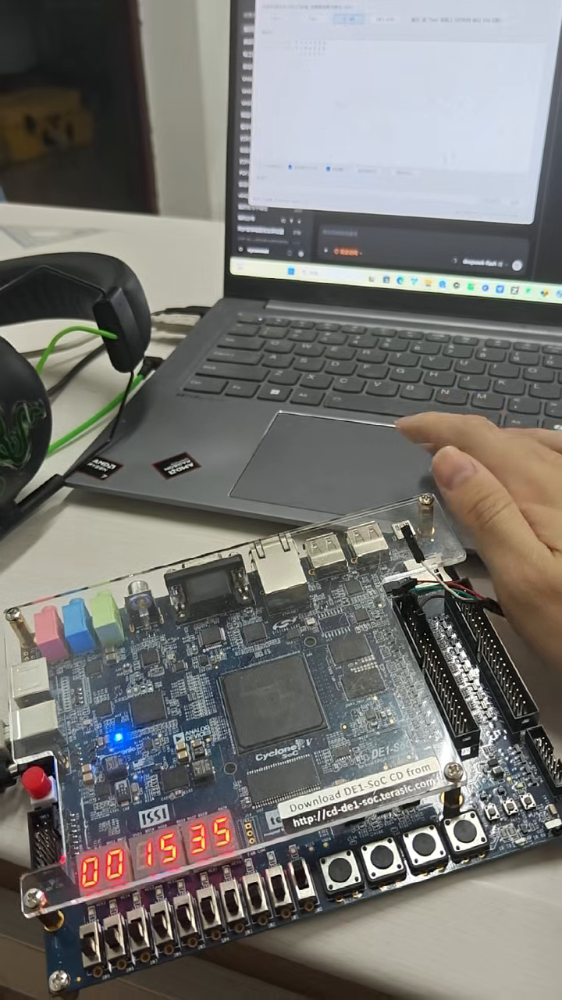
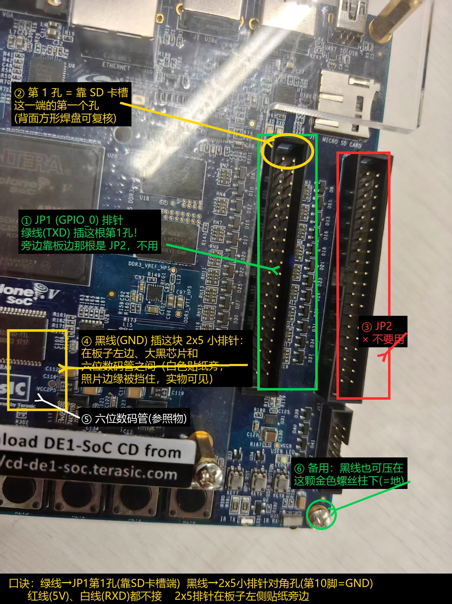
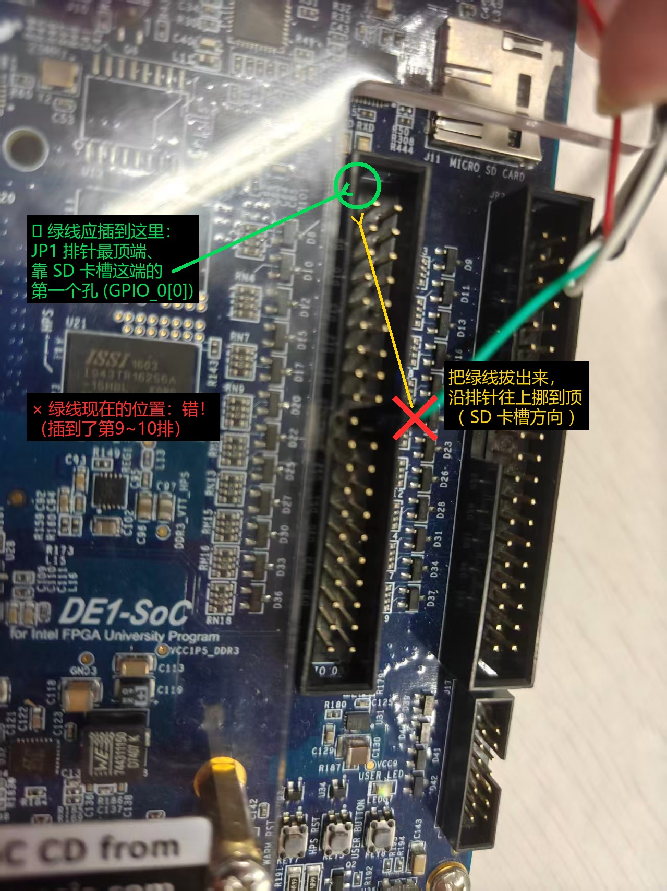
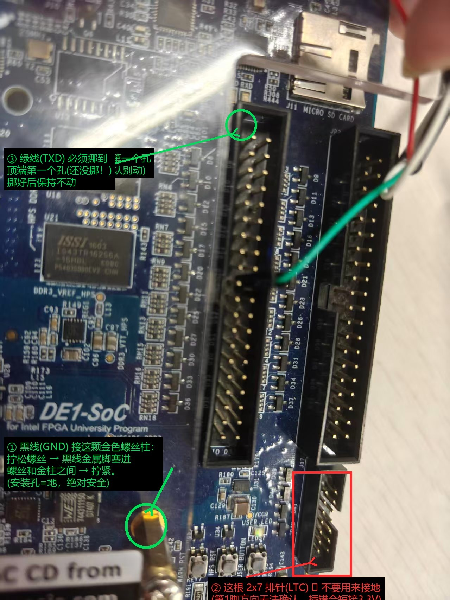
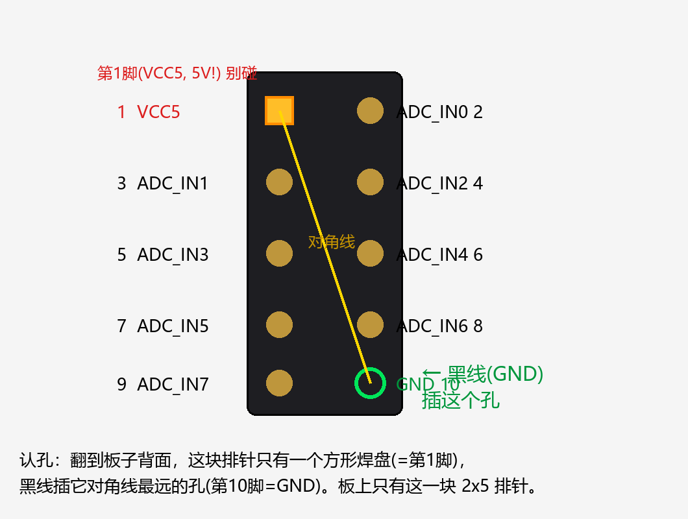
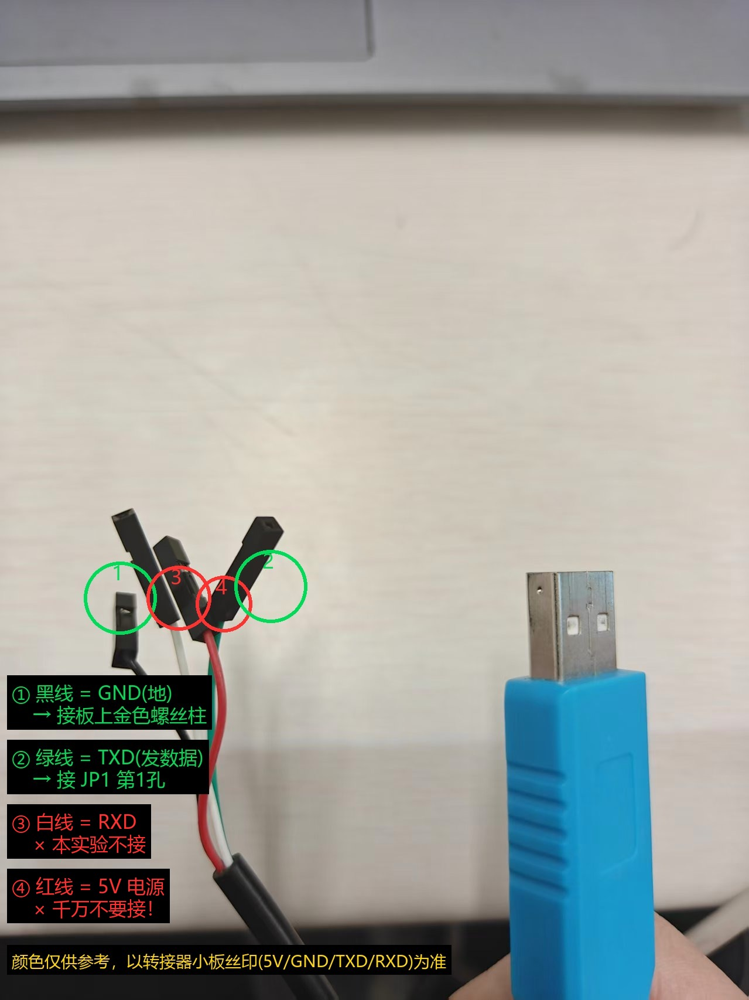
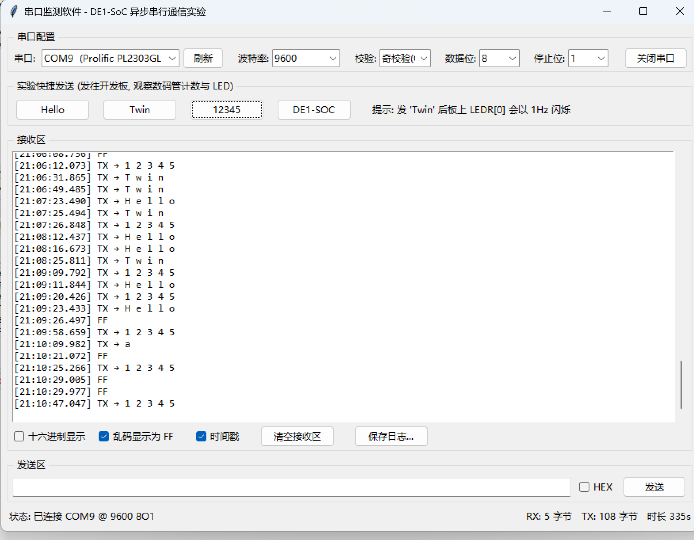

# 异步串行通信 —— 数据接收与监测（DE1-SoC / Quartus II）

> 实验指导书配套工程：UART 异步串行接收、字符计数与显示、"Twin" 字符串识别、按键停止/复位、校验与帧错误监测，并支持**拨码开关在线切换波特率与校验模式**。

- **平台**：友晶 DE1-SoC（Cyclone V SoC `5CSEMA5F31C6`，50 MHz）
- **开发软件**：Quartus II 13.1（Full / Lite 皆可）+ ModelSim ALTERA
- **语言**：Verilog HDL
- **配套上位机**：`pc_tool/uart_monitor.py`（Python + pyserial 图形界面串口监测工具）

---

## 1. 功能一览

| 类别 | 功能 | 说明 |
|---|---|---|
| 接收 | UART 帧解析 | `1 起始位 + 8 数据位(低位先发) + 校验位 + 1 停止位` |
| 接收 | 16 倍过采样 + 三点表决 | 位中心连续采样 3 次三取二，滤除边沿抖动 |
| 接收 | **波特率在线切换** | `SW[1:0]`：`00`=9600 `01`=19200 `10`=38400 `11`=115200 |
| 接收 | **校验模式在线切换** | `SW[3:2]`：`00`=奇校验 `01`=偶校验 `1x`=无校验 |
| 显示 | 字符计数 | `HEX5~HEX2` 十进制 `0000~9999`（BCD 直接计数，9999 饱和） |
| 显示 | 最近字符 | `HEX1~HEX0` 显示该字符 ASCII 码的十六进制（如 `'n'` → `6E`） |
| 识别 | "Twin" 序列检测 | 连续收到 `T w i n` 后 `LEDR[0]` 以 1 Hz 持续闪烁 |
| 识别 | 容错检测模式 | `SW[4]=1` 时允许字符间插入无关字符（`Txxwin` 也能识别） |
| 按键 | 停止闪烁 | `KEY[0]`，低有效，20 ms 消抖；计数与显示不受影响 |
| 按键 | 系统复位 | `KEY[1]`，低有效，20 ms 消抖；清零 + 消隐 |
| 监测 | 奇偶校验错 | 校验不符的帧被丢弃，`LEDR[3]` 亮 300 ms |
| 监测 | 帧错误 | 停止位不为 1 的帧被丢弃，`LEDR[4]` 亮 300 ms |
| 监测 | 接收活动 | 每收到一字节 `LEDR[1]` 亮 100 ms |
| 其他 | 上电复位 | 上电自动保持 10 ms 复位 |

### 数码管 / LED 约定

```
HEX5 HEX4 HEX3 HEX2 | HEX1 HEX0
千   百   十   个   | 最近字符 ASCII 码（十六进制）
```

| LED | 含义 |
|---|---|
| `LEDR[0]` | Twin 识别成功后 1 Hz 闪烁 |
| `LEDR[1]` | 接收活动（每字节亮 100 ms） |
| `LEDR[2]` | 闪烁使能常亮（闪烁功能开启中） |
| `LEDR[3]` | 奇/偶校验错误 |
| `LEDR[4]` | 帧错误（停止位错） |
| `LEDR[5]` | `SW[4]`（容错模式）镜像 |
| `LEDR[6]` | `SW[2]`（校验：奇/偶）镜像 |
| `LEDR[7]` | `SW[3]`（有/无校验）镜像 |
| `LEDR[8]` | `SW[0]`（波特率低位）镜像 |
| `LEDR[9]` | `SW[1]`（波特率高位）镜像 |

> `LEDR[9:5]` 实时镜像拨码开关状态，上板时可直接核对当前配置。

---

## 2. 实测现象（视频与截图）

### 2.1 Twin 识别 + 计数 + 复位



发送 `Twin` 后（9600 / 奇校验 / 开关全 DOWN）：

- `HEX5~HEX2 = 0004` —— 累计收到 4 个字符
- `HEX1~HEX0 = 6E` —— 最近字符 `'n'`，ASCII `0x6E`
- 随后按 `KEY[1]`（系统复位）：显示变为 `0000`，字符位消隐

完整过程见 [`docs/videos/demo_display_and_reset.mp4`](docs/videos/demo_display_and_reset.mp4)（3.7 s，含按键复位）。

### 2.2 连续发送与计数递增



连续发送 `Hello` / `Twin` / `12345` 等字符串后：

- `HEX5~HEX2 = 0015` —— 累计 15 个字符
- `HEX1~HEX0 = 35` —— 最近字符 `'5'`，ASCII `0x35`

完整过程见 [`docs/videos/demo_counting.mp4`](docs/videos/demo_counting.mp4)（19.5 s，期间的收发记录见 `docs/images/pc_tool_gui.png`）。

### 2.3 现象对照表

| 发送内容 | 期望显示 | 实测 |
|---|---|---|
| `Hello`（首次） | `0005 6F` | ✅ |
| `Twin` | 计数 +4，字符 `6E`，`LEDR[0]` 1 Hz 闪烁 | ✅ |
| `12345` | 计数 +5，字符 `35` | ✅ |
| 按 `KEY[0]` | 闪烁停止，计数不变 | ✅ |
| 按 `KEY[1]` | `0000` 且字符位消隐 | ✅ |
| 校验位设错 | 字节被丢弃，计数不变，`LEDR[3]` 亮 | ✅ |

---

## 3. 目录结构

```
uart-lab-de1soc/
├── fpga/                        Quartus II 工程
│   ├── uart_rx_monitor.qpf      工程文件
│   ├── uart_rx_monitor.qsf      器件 + 源文件 + 管脚约束（DE1-SoC）
│   ├── uart_rx_monitor.sdc      时序约束（50 MHz）
│   ├── pin_de1_soc.qsf          DE1-SoC 管脚约束单列（备查）
│   ├── rtl/
│   │   ├── uart_rx_monitor_top.v  顶层：复位/按键/闪烁/显示/监测
│   │   ├── uart_rx.v              UART 接收核心（波特率/校验可切换）
│   │   ├── twin_detect.v          "Twin" 检测（严格 / 容错）
│   │   ├── key_debounce.v         按键消抖
│   │   ├── bcd_counter.v          十进制计数（9999 饱和）
│   │   ├── seg7_decode.v          七段译码
│   │   ├── uart_tx.v              【备用】UART 发送，未加入编译列表
│   │   └── uart_trx_top.v         【备用】收发回显顶层，未加入编译列表
│   └── tb/
│       ├── tb_uart_rx_monitor.v   接收监测功能自检
│       ├── tb_switch.v            波特率/校验切换验证
│       └── tb_uart_trx.v          【备用】收发回显验证
├── pc_tool/
│   ├── uart_monitor.py           PC 端串口监测工具（图形界面）
│   └── requirements.txt
└── docs/
    ├── images/                   接线标注图、上位机截图
    ├── frames/                   视频关键帧（实测证据）
    └── videos/                   上板演示视频
```

> `uart_tx.v` / `uart_trx_top.v` 是后期试做的"收发回显"方案，**未加入工程编译列表**，保留供拓展实验参考。

---

## 4. 硬件连接

### 4.1 接线（只需两根线）

| USB-TTL 转接器 | 接到 DE1-SoC | 说明 |
|---|---|---|
| **绿线 TXD** | `JP1` 排针**顶端、靠 SD 卡槽端第 1 孔**（`GPIO_0[0]`，FPGA 引脚 `AC18`） | FPGA 接收 |
| **黑线 GND** | `2x5 ADC 排针第 10 脚`（第 1 脚的对角孔＝GND）；或压在**金色螺丝柱**下 | 必须共地 |
| 红线 5V | **不接** | 避免与板上电源冲突 |
| 白线 RXD | **不接**（本设计不发送） | 悬空会拾噪，接收区出现 `FF` |











### 4.2 引脚分配（DE1-SoC，见 `fpga/uart_rx_monitor.qsf`）

| 信号 | 引脚 | 板上位置 |
|---|---|---|
| `clk_50m` | `PIN_AF14` | 50 MHz 系统时钟 |
| `uart_rx` | `PIN_AC18` | `GPIO_0[0]`（JP1 第 1 孔） |
| `key_stop_n` | `PIN_AA14` | `KEY[0]` |
| `key_rst_n` | `PIN_AA15` | `KEY[1]` |
| `sw_baud[1:0]` | `PIN_AC12` / `PIN_AB12` | `SW[1]` / `SW[0]` |
| `sw_par[1:0]` | `PIN_AF10` / `PIN_AF9` | `SW[3]` / `SW[2]` |
| `sw_tolerant` | `PIN_AD11` | `SW[4]` |
| `ledr[9:0]` | `PIN_Y21 … PIN_V16` | 红色 LED |
| `hex0~hex5` | 见 qsf | 六位数码管（段 `a~g` 低有效） |

> 若改用 DE10-Standard，请把 `.qsf` 中 `DEVICE` 改为 `5CSXFC6D6F31C6` 并替换引脚段（`pin_de1_soc.qsf` 文件头有说明）。

---

## 5. 编译与烧录

```bash
# 编译（生成 uart_rx_monitor.sof）
quartus_sh --flow compile uart_rx_monitor

# 烧录：链上第 1 颗是 HPS，FPGA 是第 2 颗，务必指定 @2
quartus_pgm -m jtag -o "p;uart_rx_monitor.sof@2"
```

确认链路：

```bash
jtagconfig
# 1) DE-SoC [USB-1]
#   4BA00477   SOCVHPS        <- HPS（第 1 颗）
#   02D120DD   5CSE(BA5|MA5)  <- FPGA（第 2 颗）
```

---

## 6. 上板验证步骤

**前置**：烧录后 `SW0~SW4` 全部拨到 **DOWN**（9600 / 奇校验 / 严格匹配），`LEDR[9:5]` 应全灭。

| 步骤 | 操作 | 预期 |
|---|---|---|
| 1 | 串口助手/上位机设 **9600-8-O-1**，发送 `Hello` | `0005 6F`，`LEDR[1]` 随字节闪 |
| 2 | 发送 `Twin` | 计数 +4，`LEDR[0]` 1 Hz 闪烁，`LEDR[2]` 常亮 |
| 3 | 按 `KEY[0]` | 闪烁停止，**计数不变** |
| 4 | 再发 `Twin` | 闪烁恢复 |
| 5 | 按 `KEY[1]` | `0000`，字符位消隐，LED 全灭 |
| 6 | `SW0` 拨 UP，上位机波特率改 **19200**，发 `ABC` | 计数继续增加，`LEDR[8]` 亮 |
| 7 | 保持 19200，上位机改回 **9600** 发字符 | 收不到或显示 `FF`（**参数必须一致**） |
| 8 | `SW2` 拨 UP，上位机改 **偶校验**，发数据 | 正常计数，`LEDR[6]` 亮 |
| 9 | 上位机改回 **奇校验** 发数据 | 计数不增，`LEDR[3]` 亮（校验拦截） |
| 10 | `SW3` 拨 UP，上位机改 **无校验** | 正常计数，`LEDR[7]` 亮 |
| 11 | `SW4` 拨 UP，发 `Txxwin` | 仍识别（容错模式，对应思考题 2） |

---

## 7. 仿真验证

```bash
vlib work
vlog -work work fpga/rtl/uart_rx_monitor_top.v fpga/rtl/uart_rx.v \
     fpga/rtl/key_debounce.v fpga/rtl/twin_detect.v \
     fpga/rtl/bcd_counter.v fpga/rtl/seg7_decode.v fpga/tb/tb_uart_rx_monitor.v
vsim -c -do "run -all; quit -f" work.tb_uart_rx_monitor
```

| 测试平台 | 覆盖内容 | 结果 |
|---|---|---|
| `tb_uart_rx_monitor.v` | 普通字符、计数、字符显示、Twin 闪烁、停止键、校验错/帧错、复位、容错/严格模式 | `ALL TESTS PASSED` |
| `tb_switch.v` | 9600 奇校验、9600 偶校验（含故意错校验）、9600 无校验、38400、115200 | `ALL SWITCH TESTS PASSED` |

Quartus 全编译结果（DE1-SoC）：**0 Error**，244 ALM（<1%），Setup slack +14 ns 量级。

---

## 8. PC 端串口监测工具



```bash
pip install pyserial
python pc_tool/uart_monitor.py
```

功能：串口自动检测（标注 USB-TTL 转接器）、收发、字节计数、时间戳、ASCII/HEX 双模式、
**"乱码显示为 FF"**（不可打印字节统一显示 `FF`，便于识别失配/噪声）、一键发送
`Hello`/`Twin`/`12345`、日志保存。

> 说明：本设计 FPGA 只收不发，所以上位机**接收区正常情况下应为空**。若出现零星 `FF`，
> 是白线（RXD）悬空拾噪所致，把白线拔掉即可。

---

## 9. 常见问题

| 现象 | 原因 / 处理 |
|---|---|
| 完全收不到字符 | 绿线不在 `JP1` 第 1 孔；**未共地**；串口助手校验模式与开关不一致 |
| 收到的字节计数增加但字符值不对 | 波特率/校验与板上开关设置不一致（见步骤 6~10） |
| 计数不增、`LEDR[3]` 亮 | 校验模式不匹配（例如板上奇校验、上位机选无校验） |
| 计数不增、`LEDR[4]` 亮 | 波特率相差过大导致停止位判错 |
| 波特率失配时显示 `FF` | 快帧整帧被采成"全 1"，`FF` 恰好通过奇校验被当成有效字节——这是失配的典型特征，不是随机乱码 |
| `jtagconfig` 报 `JTAG chain broken` | 断电 10~60 s 重启 + USB 重插；必要时清理 USB 幽灵设备并重启 JTAGServer 服务 |
| 烧录报 `Expected JTAG ID 0x02D120DD but found 0x02D020DD` | 链路信号质量差导致的 ID 误读，重试即可；`.sof` 与器件本身不匹配时才需重编译 |

---

## 10. 设计要点（可写入报告）

1. **异步接收**：`rx` 经两级触发器同步后做下降沿检测，避免亚稳态直接进入状态机。
2. **过采样与表决**：每个位时间 16 等分（`os_cnt`），在 `os_cnt=6/7/8` 三点采样并三取二，
   采样点位于位中心，对 ±5% 波特率误差仍有裕量。
3. **可配置**：`bit_div`（1/16 位时间的时钟数）与 `par_mode` 由拨码开关在运行期给出，
   帧间切换安全，无需重新编译。
4. **帧校验**：停止位必须为 1；奇/偶校验由 `^{数据, 校验位}` 的奇偶判定；无校验模式跳过校验位状态。
5. **计数显示**：BCD 直接进位计数，省去除法电路，9999 饱和不翻转。
6. **序列识别**：4 字节移位寄存器做严格比对；容错模式用 4 状态 FSM，未匹配到期望字符时保持进度。
7. **按键**：计数消抖（连续稳定 20 ms 才承认），低有效。

### 思考题要点

| 问题 | 要点 |
|---|---|
| 为什么在位中间采样 | 检测延迟与波特率误差会让采样点漂移，位中心采样可容忍接近 ±1/2 位周期的偏移；边沿采样遇抖动/上升沿时间直接误码 |
| 允许插入无关字符如何识别 | 用状态机记录已匹配进度，未匹配期望字符时保持进度，遇 `'T'` 重新开始（本工程 `SW[4]=1`） |
| 为什么需要消抖 | 机械触点 5~20 ms 抖动会产生多次跳变；方案：计数消抖、移位寄存器连续采样、采样节拍、施密特触发器 |
| 计数溢出如何处理 | BCD 饱和（本设计 9999 停住）；或扩展位数 / 二进制计数 + 双 dabble 转十进制 |

---

## 11. 版本说明

| 日期 | 内容 |
|---|---|
| 2026-10-31 | 初版：接收 + 计数显示 + Twin 识别 + 停止/复位 + 校验/帧错监测（ModelSim 通过，上板验证） |
| 2026-10-31 | 新增 `SW[1:0]` 波特率切换、`SW[3:2]` 校验模式切换（含无校验）、`LEDR[9:5]` 配置镜像；`tb_switch.v` 全部用例通过 |
| 2026-10-31 | 新增 PC 端串口监测工具（`pc_tool/`） |

---

## 许可证

本项目基于 [MIT License](LICENSE) 开源，可自由使用、修改与分发（保留版权声明即可）。
实验工程、文档与调试工具均为原创实现；演示视频/照片为作者本人实验记录。
